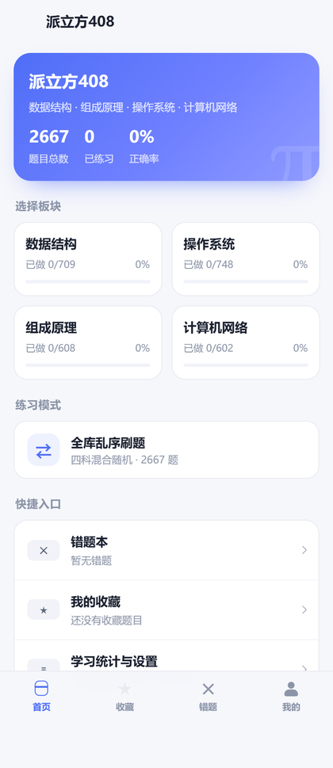
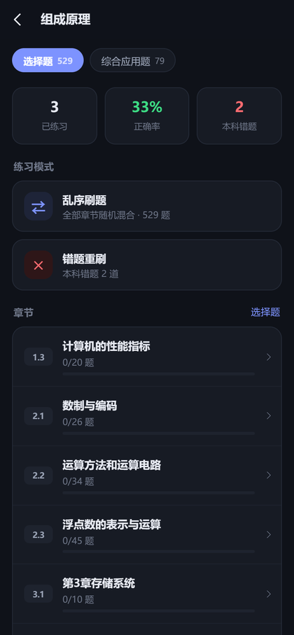
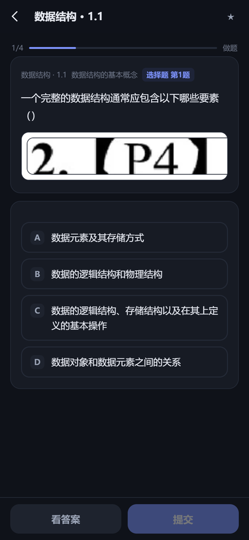
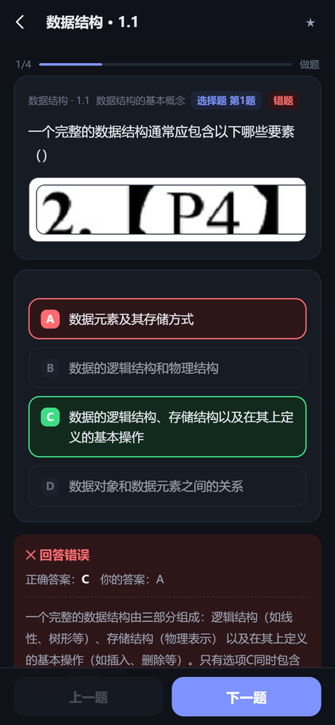
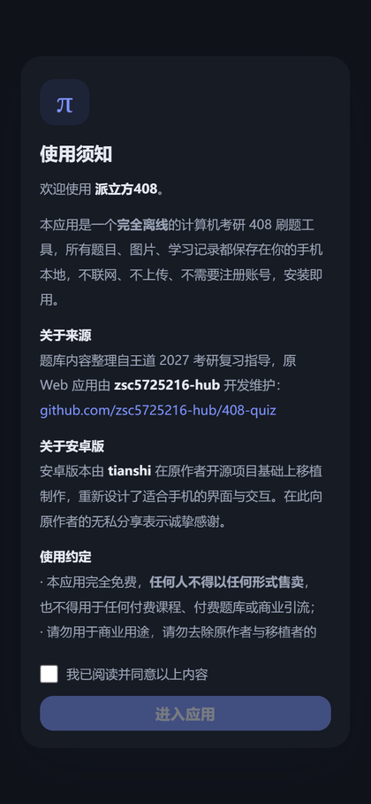
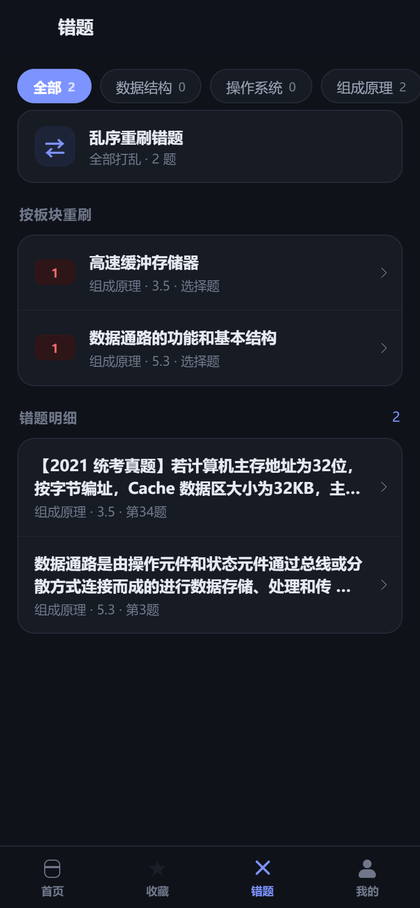
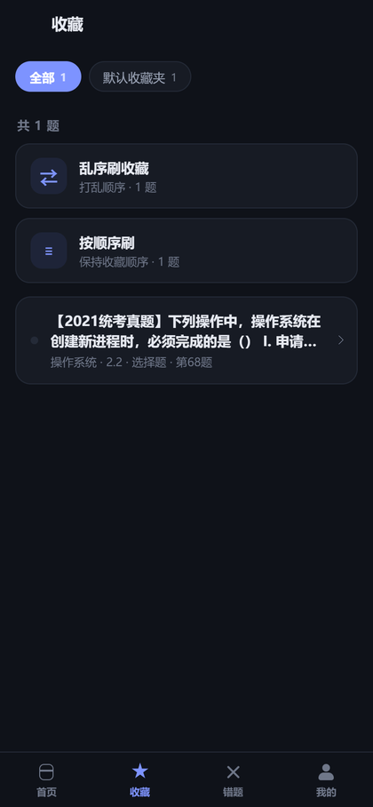

# 派立方408

> 计算机考研 408 四科的**离线安卓刷题 App** —— 数据结构 · 计算机组成原理 · 操作系统 · 计算机网络

|    |    |    |    |
|:--:|:--:|:--:|:--:|
| 首页 | 分板块 · 分题型 | 做题模式 | 即时判分与解析 |

---

## 这是什么

**派立方408** 是一个为手机从头设计的 408 刷题应用。它把 **2667 道题**（选择题 2235 道 + 综合应用题 432 道）连题库带配图全部打进安装包，**不联网、不注册、不上传任何数据**，装上就能用。

题目内容整理自《王道 2027 考研复习指导》，原始的 Web 版刷题网站由 [zsc5725216-hub](https://github.com/zsc5725216-hub/408-quiz) 开发。这个安卓版是在原项目开源的基础上移植并重新设计交互的，**在此向原作者的无私分享表示感谢**。

> 本项目完全免费开源。**任何人不得以任何形式售卖**，也不得用于付费课程、付费题库或商业引流。

## 功能

**分板块 · 分题型**
- 四科独立入口，每科分「选择题」与「综合应用题」两种题型
- 章节颗粒度进度：已做 / 总数、正确率、该章错题数

**看题模式 · 做题模式**
- 进入任意章节先选模式：
  - **做题模式** —— 先作答，提交后立即判分并展开解析
  - **看题模式** —— 直接显示答案与解析，适合快速过题、考前速览
- 选择题支持单选与多选；综合应用题提供「思路提示 → 显示解答 → 自评对错」

**乱序刷题**
- 每个科目板块都能一键**把全部章节的题打乱混刷**，每题仍标注来源章节
- 首页还提供「全库乱序」：四科 2667 题整体洗牌
- **每次进入顺序都不同**；点「再来一次」会重新洗牌并保证与上一轮不同

**收藏夹**
- 右上角 ★ 一键收藏，支持**自建多个收藏夹**、改名、删除
- 一道题可同时归入多个收藏夹
- 收藏页可按收藏夹筛选，支持「乱序刷收藏」与「按顺序刷」

**错题本**
- 答错自动收录并累计错误次数，答对后自动移出
- 可按科目筛选、按「科目 + 章节 + 题型」分组**整组重刷**
- 也支持全部错题乱序重刷

**其他**
- 深色 / 浅色 / 跟随系统主题，三档正文字号
- 学习数据可导出为 JSON
- 全部记录存于本机 `localStorage`，卸载即清空，不产生任何网络请求

## 截图

|    |    |    |
|:--:|:--:|:--:|
| 首次启动协议 | 错题本 · 分组重刷 | 收藏夹 · 两种刷法 |

---

## 技术实现

应用是「**原生壳 + 本地前端**」的结构，在保证体验的同时让界面代码保持可维护：

```
Android 原生 (Java)          负责：图标、启动、返回键、系统栏、文件导出
    └── WebView
          └── 本地 HTML/CSS/JS  (assets/web/)   负责：全部界面与刷题逻辑
                └── 内置题库 + 配图 (assets/web/data, assets/web/img)
```

- **零网络权限**：`AndroidManifest.xml` 中没有 `INTERNET` 权限，物理上无法联网
- **资源全部内嵌**：题库 JSON 与 431 张配图随 APK 分发，不走远程请求
- **不依赖任何第三方库**：没有 AndroidX、没有 Gradle 依赖，前端也是零框架原生 JS
- **构建脚本自包含**：`tools/build_apk.py` 直接调用 `aapt2 / javac / d8 / zipalign / apksigner` 完成打包，不装 Android Studio 也能出包

### 目录结构

```
408-quiz/
├── android/app/src/main/
│   ├── AndroidManifest.xml
│   ├── java/com/tianshi/pai408/MainActivity.java   原生壳：WebView + assets 路由 + 返回键
│   ├── assets/web/                                 前端（打进 APK 的部分）
│   │   ├── index.html
│   │   ├── css/app.css
│   │   ├── js/app.js
│   │   ├── data/{ds,os,co,cn}.json                 四科题库
│   │   └── img/{ds,os,co,cn}/...                   配图（WebP）
│   └── res/                                        图标、主题、字符串
├── tools/
│   ├── build_assets.py       题库原数据 -> App 资源（含转 WebP）
│   ├── make_icons.py         生成各密度启动图标
│   ├── make_adaptive_fg.py   生成自适应图标前景
│   ├── build_apk.py          一条命令出签名 APK
│   ├── check_apk.py          校验 dex/arsc 未压缩与对齐
│   └── check_images.py       校验题目引用的配图无缺失
├── data/                     上游原始题库（中文文件名 + PNG 原图）
├── docs/screenshots/
├── dist/                     构建产物
└── README.md
```

### 题库格式

`android/app/src/main/assets/web/data/<sid>.json`：

```jsonc
{
  "id": "ds",
  "name": "数据结构",
  "sections": [
    {
      "id": "1.1",
      "title": "数据结构的基本概念",
      // 选择题: [题号, 答案, 题干, 解析, [选项...], 配图|null]
      "xzt": [[1, "C", "……（　）", "解析文本", ["A. …", "B. …"], "img/ds/1.1/q_1.webp"]],
      // 综合题: [题号, 题干, 解答, [[标记, 提示]...], 题图|null, 解答图|null]
      "bigq": [[1, "对于两种不同的数据结构……", "参考答案……", [["", "关键点"]], null, null]]
    }
  ]
}
```

`sid` 取值为 `ds` 数据结构 / `os` 操作系统 / `co` 计算机组成原理 / `cn` 计算机网络。

---

## 自己构建

### 需要什么

| 依赖 | 说明 |
|---|---|
| Python 3.8+ | 构建脚本；转换图片另需 `pillow` |
| JDK | `d8 / apksigner / keytool` 需 **JDK 11+**；`javac` 建议 **JDK 8**（新版 javac 的泛型签名会让旧版 d8 崩溃） |
| Android SDK | `build-tools;34.0.0` 与 `platforms;android-34` |

用 `sdkmanager` 安装 SDK 组件：

```bash
sdkmanager "platform-tools" "platforms;android-34" "build-tools;34.0.0"
```

### 出包

```bash
pip install pillow

# 1) 题库 -> App 资源（生成 JSON 并把 PNG 转 WebP）
python tools/build_assets.py

# 2) 生成图标
python tools/make_icons.py
python tools/make_adaptive_fg.py

# 3) 打包，产物在 dist/
export ANDROID_SDK_ROOT=/path/to/android-sdk
export JAVA_HOME=/path/to/jdk11+        # d8 / apksigner
export JAVAC_HOME=/path/to/jdk8         # 可选，指定 javac
python tools/build_apk.py
```

### 用自己的签名发布

脚本默认自动生成一把**本地调试密钥**（`.build/debug.keystore`），仅供本机安装测试。
正式发布请换成自己的密钥：

```bash
keytool -genkeypair -keystore my-release.keystore -alias pai408 \
        -keyalg RSA -keysize 2048 -validity 10000

export PA408_KEYSTORE=/abs/path/my-release.keystore
export PA408_KS_ALIAS=pai408
export PA408_KS_PASS='你的store密码'
export PA408_KEY_PASS='你的key密码'
export VERSION_NAME=1.0.1
export VERSION_CODE=2
python tools/build_apk.py
```

### 校验

```bash
python tools/check_apk.py dist/派立方408-v1.0.apk      # dex/arsc 必须 STORED 且 4 字节对齐
python tools/check_images.py dist/派立方408-v1.0.apk   # 题目引用的配图是否齐全
```

---

## 开发说明

前端是零依赖的 vanilla JS，调试时不必每次都打包 APK —— 直接起一个静态服务器即可：

```bash
cd android/app/src/main/assets/web
python -m http.server 8899
# 浏览器打开 http://127.0.0.1:8899/index.html
# 按 F12 切到手机模拟视图（建议 390×844）效果最接近真机
```

改完 CSS/JS 后重跑 `tools/build_apk.py` 即可反映到 APK。

**兼容性**：`minSdk 21`（Android 5.0）。旧版 WebView 不支持 flex `gap`、`inset` 与 `mask-image`，因此 `app.css` 末尾有一层 `@supports not (gap: 1px)` 兜底规则，改动布局时请保留。

---

## 已知问题

- 上游题库中有 **55 张配图在扫描裁切时偏移**（例如 1400×41 的细长条带，内容是错位残影）。这属于原始数据问题，本应用按可读高度渲染并允许横向滑动，但未篡改原图内容。

## 致谢与声明

- **题库与原始 Web 版**：[zsc5725216-hub/408-quiz](https://github.com/zsc5725216-hub/408-quiz)
- **题目内容**：《王道 2027 考研复习指导》（王道论坛），版权归原作者及出版方所有
- **安卓版移植与界面重设计**：tianshi

本项目仅供个人学习交流使用。**禁止任何形式的售卖**，禁止用于付费课程、付费题库或商业引流；请勿去除原作者与移植者的署名信息。

如果这个项目对你有帮助，欢迎点个 Star ⭐，祝你 408 顺利上岸。
