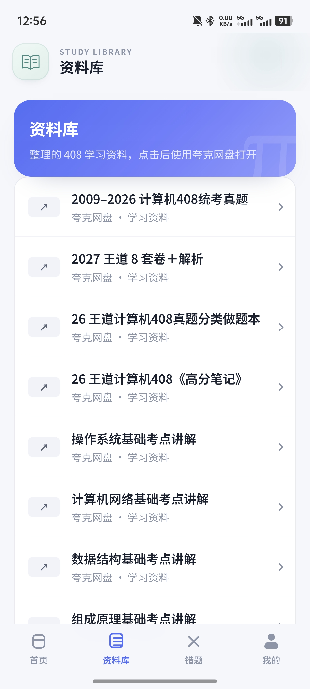
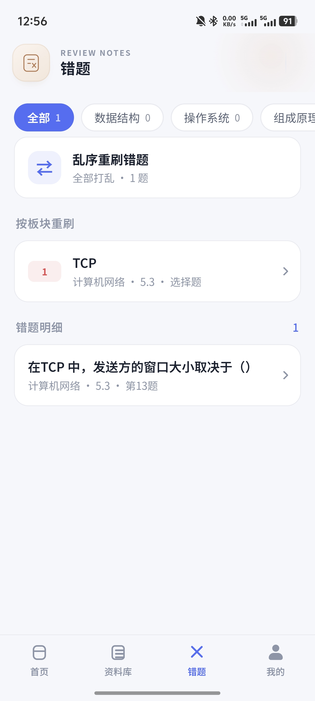
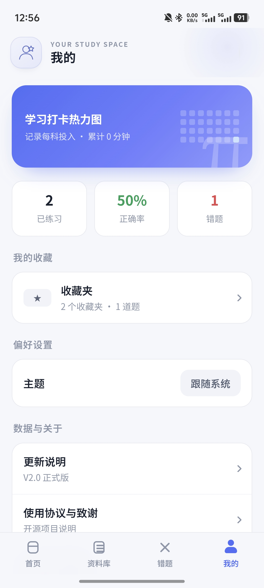
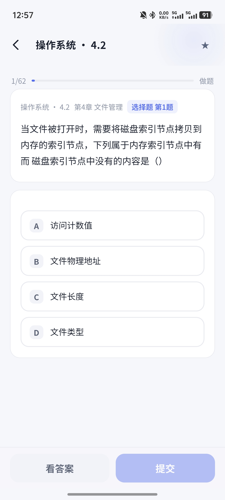
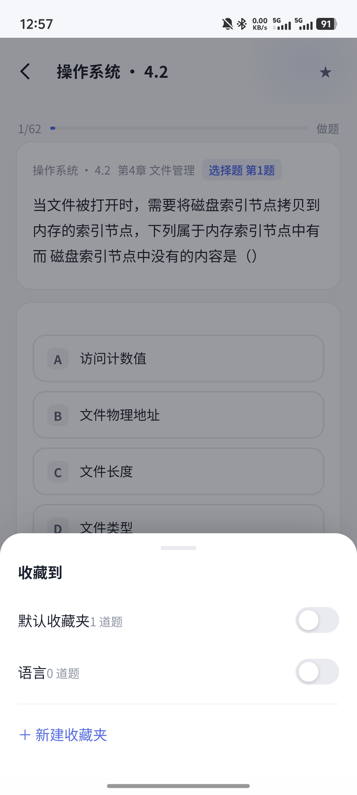
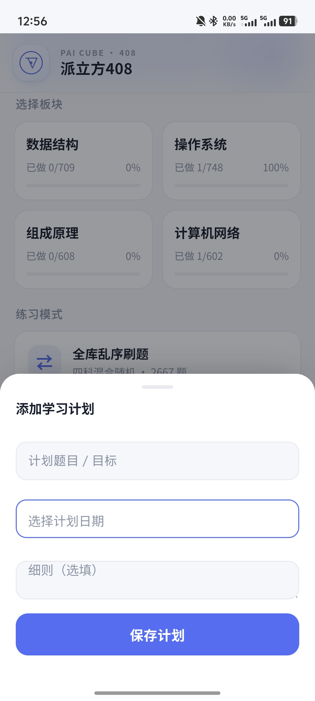
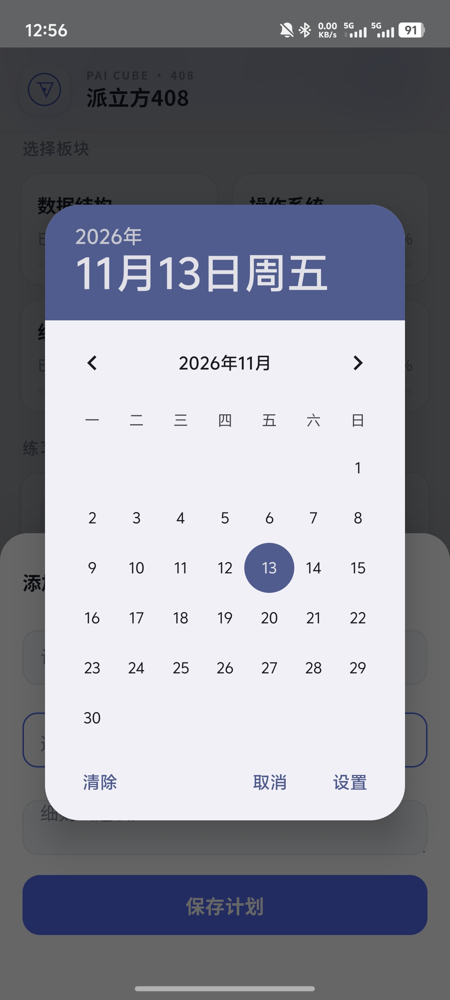
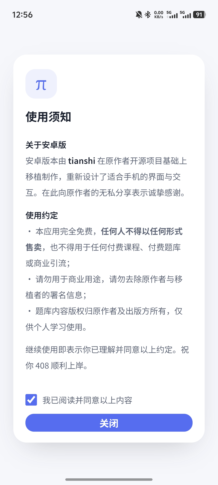

# 派立方408 · V2.4.0

一款面向计算机考研 408 的 Android 刷题应用，覆盖**数据结构、计算机组成原理、操作系统、计算机网络**。选择题、综合应用题、题目配图和学习记录整合在本地应用中；不需要注册账号。

> 当前版本：**V2.4.0** · Android 5.0（API 21）及以上

## 应用截图

<table>
  <tr>
    <td align="center"> 首页与学习计划</td>
    <td align="center"> 资料库</td>
    <td align="center"> 错题本</td>
  </tr>
  <tr>
    <td align="center"> 我的</td>
    <td align="center"> 学习时间日历</td>
    <td align="center"> 答题页面</td>
  </tr>
  <tr>
    <td align="center"> 多收藏夹</td>
    <td align="center"> 添加计划</td>
    <td align="center"> 计划日期</td>
  </tr>
  <tr>
    <td align="center"> 使用须知</td>
    <td></td>
    <td></td>
  </tr>
</table>

## 功能概览

### 刷题与复习

- 四科选择题和综合应用题，支持章节练习、做题模式、看题模式和乱序练习。
- 提交后查看答案与解析；综合题可先看思路提示，再查看参考解答并自评。
- 错题自动记录，答对后从错题本移除；支持按科目、章节和题型复习。
- 收藏题目时可选择多个自建收藏夹。

### 学习计划与时间记录

- 首页计划清单支持日期、目标和细则；可标记完成、恢复、删除和拖拽排序。
- 学习时间按题目所属科目累计，在月历热力图中查看：学习日显示浅绿色，单日超过 1 小时显示深绿色。

### 算法演示

- 底部栏「演示」入口，覆盖数据结构、组成原理、操作系统、计算机网络四科共 111 个算法演示。
- 每个演示提供伪代码逐步高亮、可视化状态与单步「下一步 / 上一步」控制，手动掌控播放节奏。
- 「资料库」已从底部栏移入「我的」页面。

### 资料库与数据

- 资料库提供 408 真题、王道练习资料和各科考点资料的网盘链接。首次打开资料库时会显示学习交流免责声明，链接由外部网盘应用打开。
- 首次启动需将使用声明滑动至底部，勾选“我已阅读并同意上述声明”后才能进入软件；侵权联系邮箱：2115729051@qq.com。
- 可选择导出错题和/或收藏，生成包含题目、选项、答案和解析的纯文本；内容会复制到剪贴板并保存到设备。
- 学习计划、学习时间、错题、收藏和练习进度保存在应用本地。升级安装可保留数据；卸载应用或清除应用数据会删除记录。
- 支持浅色、深色和跟随系统主题。

## 更新记录摘要

V2.4.0 是**功能更新版本**：

- 新增「演示」板块：从本地算法可视化项目提取动画演示与伪代码，去掉真题解析与自动播放，改为「点一下动一下」的单步按钮；按四科分板块、分入口组织，共 111 个演示，可在安卓端正常演示使用。
- 底部栏调整：新增「演示」标签，「资料库」移入「我的」页面并从底部栏移除。

题库数量与学习数据不变，无需迁移。

## 题库与资料说明

应用内置 **2667 道题**及 **431 张题目配图**。题库内容整理自《王道 2027 考研复习指导》，相关著作权及知识产权归原出版方和原作者所有，仅供个人考研复习交流。首次使用声明要求不得将本应用或修改版本用于售卖、付费题库、商业引流或倒卖，并建议支持正版实体书和官方课程。

资料库中的分享链接由开发者整理，链接内容及可用性以原分享页面为准。

## 更新记录

- [V2.4.0 更新说明](docs/更新说明-V2.4.0.md)

## 致谢

- 题库与原始 Web 应用：[zsc5725216-hub/408-quiz](https://github.com/zsc5725216-hub/408-quiz)
- Android 移植与交互设计：tianshi
