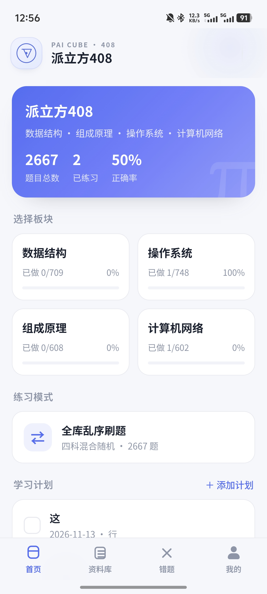
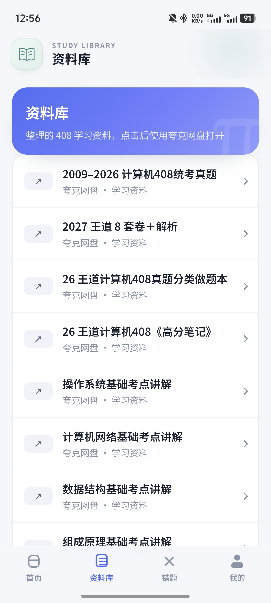
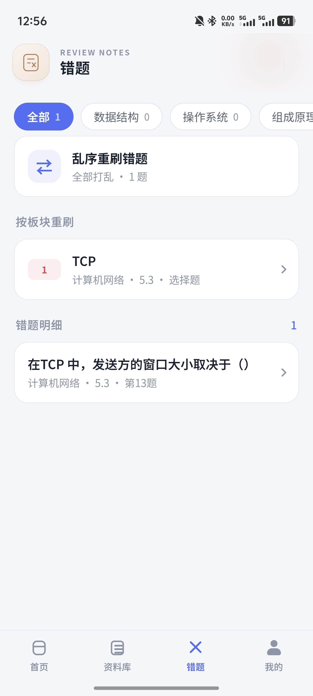
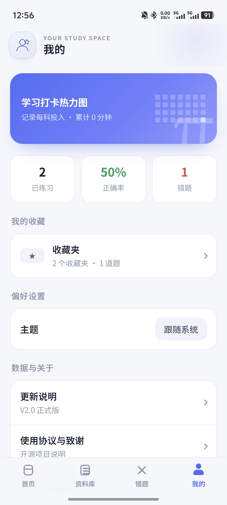
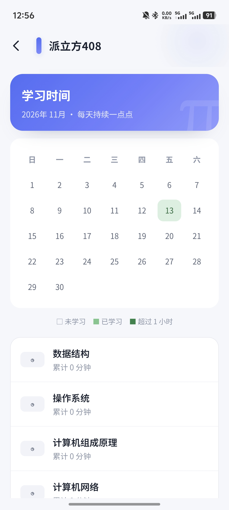
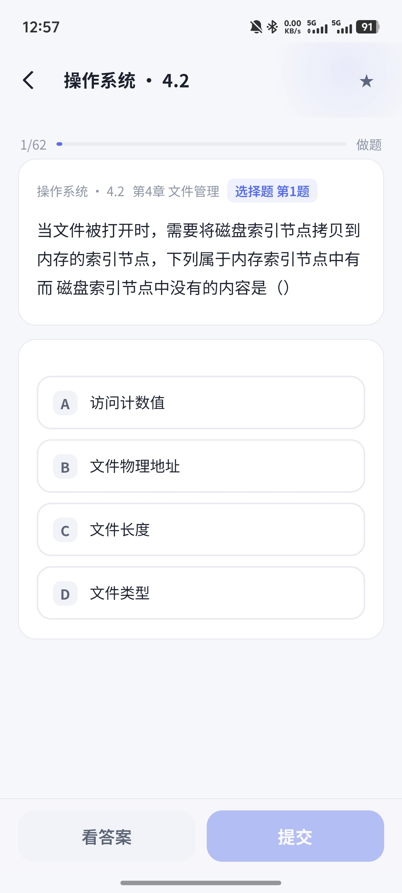
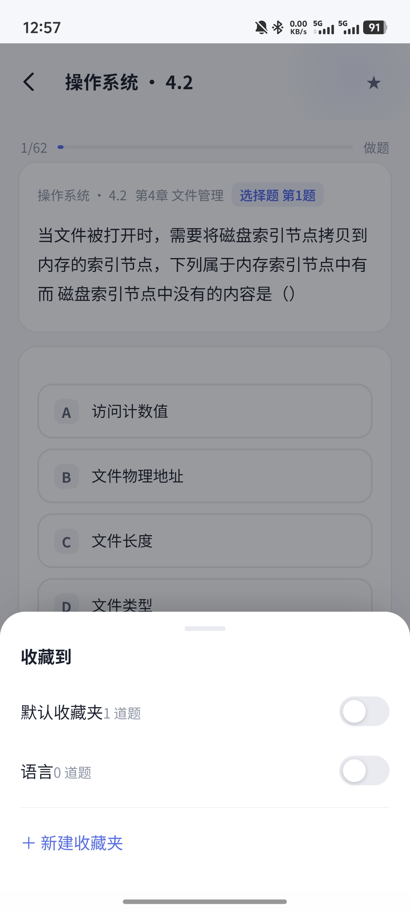
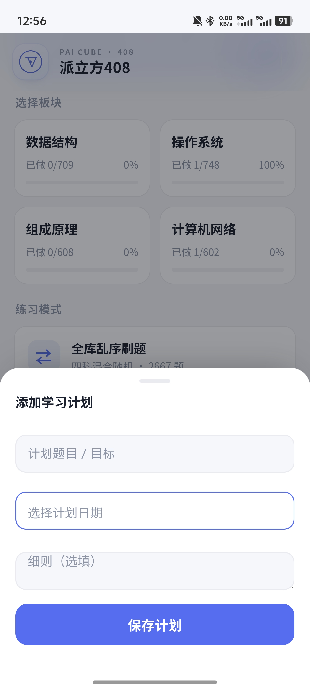
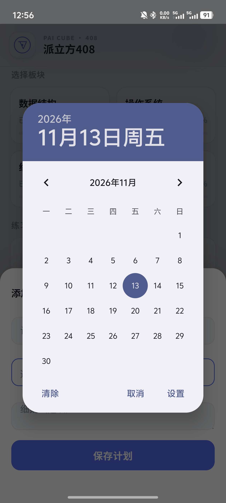
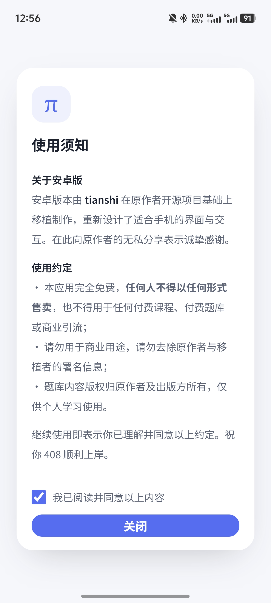

# 派立方408 · V2.0 正式版

一款面向计算机考研 408 的 Android 刷题应用，覆盖**数据结构、计算机组成原理、操作系统、计算机网络**。选择题、综合应用题、题目配图和学习记录整合在本地应用中；不需要注册账号。

> 当前版本：**V2.0 正式版** · Android 5.0（API 21）及以上

## 应用截图

<table>
  <tr>
    <td align="center"><br>首页与学习计划</td>
    <td align="center"><br>资料库</td>
    <td align="center"><br>错题本</td>
  </tr>
  <tr>
    <td align="center"><br>我的</td>
    <td align="center"><br>学习时间日历</td>
    <td align="center"><br>答题页面</td>
  </tr>
  <tr>
    <td align="center"><br>多收藏夹</td>
    <td align="center"><br>添加计划</td>
    <td align="center"><br>计划日期</td>
  </tr>
  <tr>
    <td align="center"><br>使用须知</td>
    <td align="center"><br>请作者喝咖啡</td>
    <td></td>
  </tr>
</table>

## 功能概览

### 刷题与复习

- 四科选择题和综合应用题，支持章节练习、做题模式、看题模式和乱序练习。
- 提交后查看答案与解析；综合题可先看思路提示，再查看参考解答并自评。
- 错题自动记录，答对后从错题本移除；支持按科目、章节和题型复习。
- 收藏题目时可选择多个自建收藏夹。

### 学习计划与时间记录

- 首页计划清单支持日期、目标和细则；可标记完成、恢复、删除和拖拽排序。
- 学习时间按题目所属科目累计，在月历热力图中查看：学习日显示浅绿色，单日超过 1 小时显示深绿色。

### 资料库与数据

- 资料库提供 408 真题、王道练习资料和各科考点资料的网盘链接。首次打开资料库时会显示学习交流免责声明，链接由外部网盘应用打开。
- 可选择导出错题和/或收藏，生成包含题目、选项、答案和解析的纯文本；内容会复制到剪贴板并保存到设备。
- 学习计划、学习时间、错题、收藏和练习进度保存在应用本地。升级安装可保留数据；卸载应用或清除应用数据会删除记录。
- 支持浅色、深色和跟随系统主题。

## 题库与资料说明

应用内置 **2667 道题**及 **431 张题目配图**。题目内容整理自《王道 2027 考研复习指导》，仅供个人学习交流。请尊重题库、出版物和网盘资料的版权要求；强烈不建议将资料用于二次贩卖或商业引流。

资料库中的分享链接由开发者整理，链接内容及可用性以原分享页面为准。

## 安装

从项目发布页或本地 `dist` 目录获取 `派立方408-v2.0.apk`，在 Android 设备上安装。若系统提示未知来源，需在系统设置中允许当前安装来源。

本仓库生成的 APK 使用本地调试密钥签名，适合个人安装和测试。覆盖升级需与已安装版本使用相同签名；不要先卸载旧版，否则本地学习记录会被清除。重要数据可先从“我的 → 导出学习数据”备份。

## 本地构建

应用采用原生 Java WebView 外壳与本地 HTML/CSS/JavaScript 前端，不依赖第三方 Android 库。题库和配图打包进 APK。

在 PowerShell 中运行：

```powershell
$env:ANDROID_SDK_ROOT='D:\408-quiz\.build\sdk'
$env:JAVA_HOME='C:\jdk21'
$env:JAVAC_HOME='C:\jdk8'
$env:VERSION_NAME='2.0'
$env:VERSION_CODE='9'
python tools/build_apk.py
```

构建产物位于 `dist/派立方408-v2.0.apk`。正式发布时请配置自己的发布密钥，并递增 `VERSION_CODE`。

## 开发结构

```text
android/app/src/main/
├── java/com/tianshi/pai408/MainActivity.java   WebView、系统栏、剪贴板与文件保存
└── assets/web/
    ├── index.html
    ├── css/app.css
    ├── js/app.js
    ├── data/                                   四科题库 JSON
    └── img/                                    题目配图与界面资源
```

直接预览前端：

```powershell
cd android/app/src/main/assets/web
python -m http.server 8899
```

浏览器打开 `http://127.0.0.1:8899/index.html`。原始 Web 版源码仍保留在仓库根目录的 `index.html` 与 `assets/`。

## 更新记录

- [V2.0 正式版更新说明](docs/更新说明-V2.0正式版.md)
- [V1.2 更新说明](docs/更新说明-v1.2.md)
- [V1.1 更新说明](docs/更新说明-v1.1.md)

## 致谢

- 题库与原始 Web 应用：[zsc5725216-hub/408-quiz](https://github.com/zsc5725216-hub/408-quiz)
- Android 移植与交互设计：tianshi
